# Project 1 — IAM Least-Privilege Access to S3

A hands-on demonstration of the **principle of least privilege** on IAM principals,
in three parts. Each part limits what an identity can do and is **verified** — proving
the allowed path works and everything else is denied.

1. **Scoped identity policy** — an IAM user can read *one folder* of *one bucket*, nothing else.
2. **Role assumption (trust policy)** — a user with no S3 access gains it only by assuming a role.
3. **Permissions boundary** — a user with `AdministratorAccess` is still capped to S3/CloudWatch only.

> **Why this matters:** Over-permissive IAM is one of the most common causes of cloud
> data exposure. These three controls limit the "blast radius" if credentials are ever
> compromised: a scoped policy, role separation (who-can-assume vs what-they-can-do),
> and a hard ceiling that even an admin grant cannot exceed.

> **Note:** The policy JSONs use the placeholder account id `111122223333`. Replace it
> with your own account id to reuse them. No real credentials or access keys are in this repo.

---

## Part 1 — Scoped identity policy (read only `reports/`)

**Scenario:** an auditor (`Alice`) needs read-only access to reports under the
`reports/` prefix of a bucket. She must **not** list all buckets, read files outside
`reports/`, or write anything.

```
IAM user: Alice
   └── member of group: reports-readers
          └── policy: S3ReportsReadOnly  (customer managed)
                 ├── s3:ListBucket  on the bucket  (ONLY when prefix = reports/*)
                 └── s3:GetObject   on bucket/reports/*
```

Permissions are attached to the **group**, not the user — adding more auditors later
just means adding them to the group.

Policy: [`policies/S3ReportsReadOnly.json`](policies/S3ReportsReadOnly.json). Two design
decisions make it least-privilege:

1. **`ListBucket` is gated by a condition** — `s3:prefix` must match `reports/*`, so
   listing the bucket root is denied.
2. **`GetObject` is scoped to `reports/*`** — the object ARN ends in `/reports/*`, so
   files elsewhere in the bucket cannot be read.

```json
"Condition": { "StringLike": { "s3:prefix": "reports/*" } }
```

### Verification

| # | Action attempted | Expected | Result |
|---|------------------|----------|--------|
| 1 | Download `reports/hello.txt` | Allow | ✅ Completed (5 bytes) |
| 2 | List all buckets in the account | Deny | ❌ `s3:ListAllMyBuckets` denied |
| 3 | List the bucket **root** (no prefix) | Deny | ❌ `s3:ListBucket` denied by prefix condition |
| 4 | Upload `one.txt` to `reports/` | Deny | ❌ Access denied (no write permission) |
| 5 | Open `secret.txt` (outside `reports/`) | Deny | ❌ No permission to get object |

**Allowed — `reports/hello.txt` is listed and downloads:**

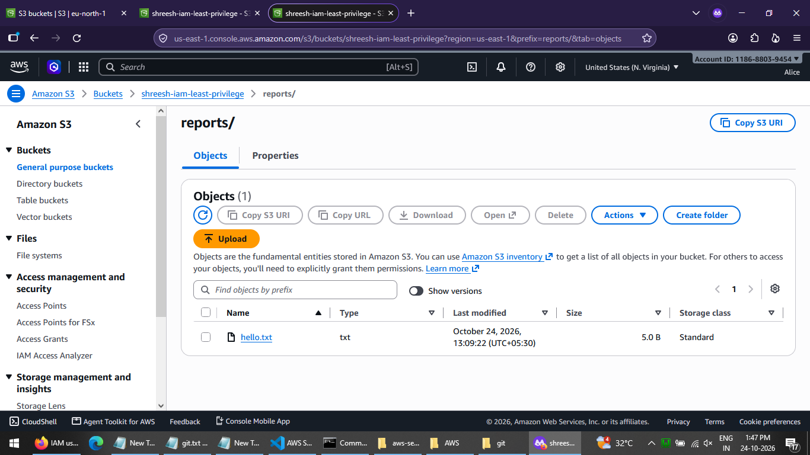
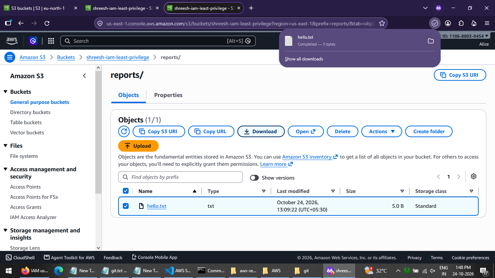

**Denied — listing all buckets, and listing the bucket root:**

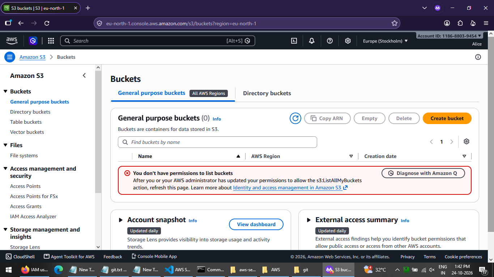
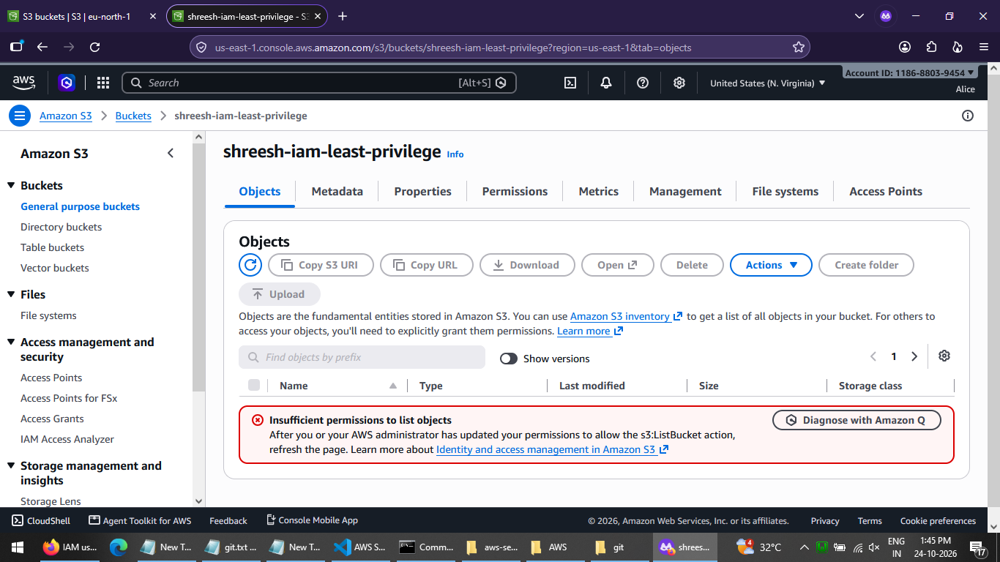

**Denied — uploading to `reports/`, and reading `secret.txt`:**

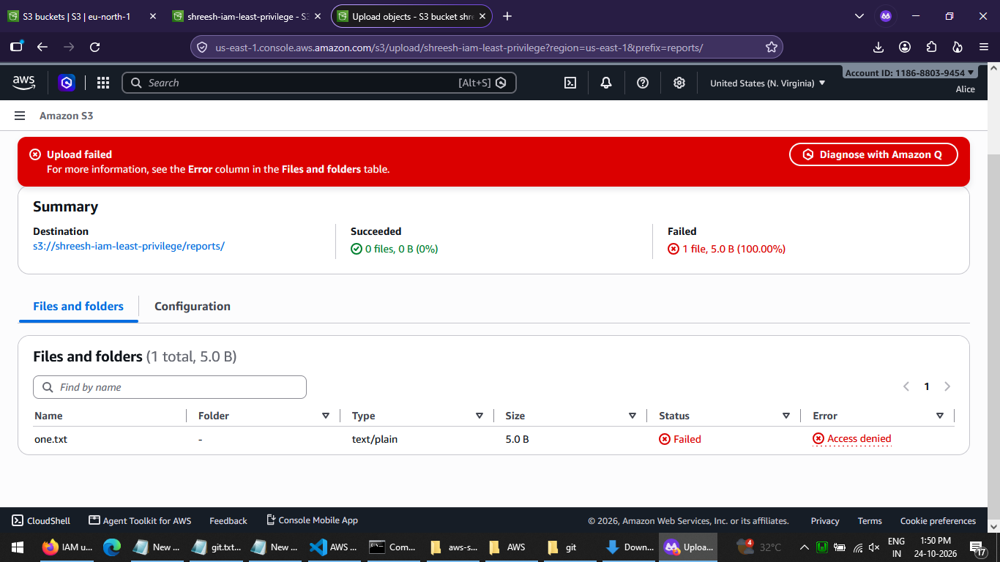
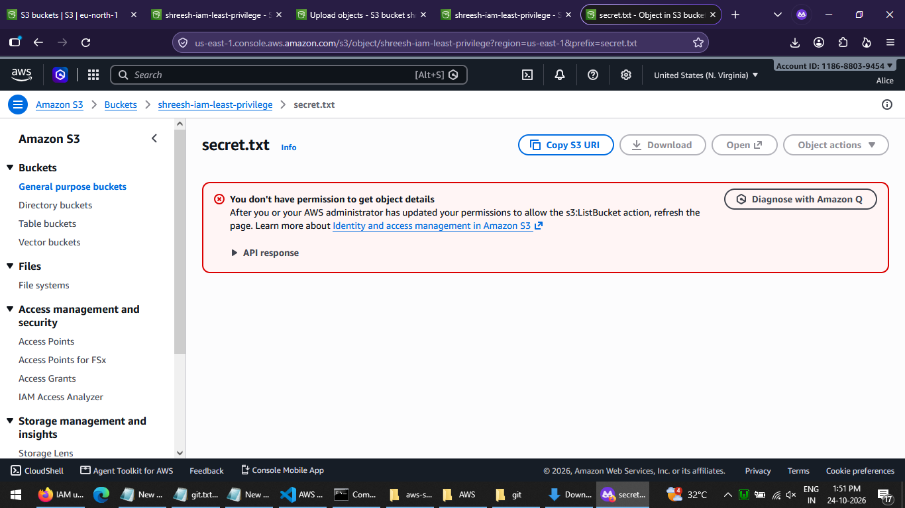

---

## Part 2 — Role assumption (trust policy vs permission policy)

**Scenario:** a user (`bob`) has **no S3 access at all**. He should be able to read the
reports **only** by assuming a dedicated role — demonstrating the difference between a
**trust policy** (*who may assume the role*) and a **permission policy** (*what the role
can do*).

```
IAM user: bob
   └── inline policy: sts:AssumeRole on reports-auditor-role   (and nothing else)

IAM role: reports-auditor-role
   ├── trust policy:      Principal = bob            → who may assume   (WHO)
   └── permission policy: S3ReportsReadOnly          → read reports/*   (WHAT)
```

Policies:
- Role trust policy — [`policies/reports-auditor-role-trust-policy.json`](policies/reports-auditor-role-trust-policy.json)
- `bob`'s inline policy — [`policies/bob-assume-role.json`](policies/bob-assume-role.json)
- Role permission policy — reuses [`policies/S3ReportsReadOnly.json`](policies/S3ReportsReadOnly.json)

### Verification

| # | Action attempted | Expected | Result |
|---|------------------|----------|--------|
| 1 | As `bob` directly, access S3 | Deny | ❌ No permission to list buckets |
| 2 | `bob` switches into `reports-auditor-role`, reads `reports/hello.txt` | Allow | ✅ File listed and readable |

**`bob` directly has no S3 access:**

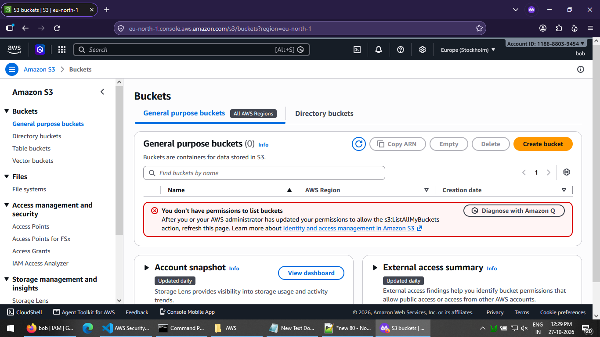

**After assuming `reports-auditor-role`, `reports/hello.txt` is readable:**

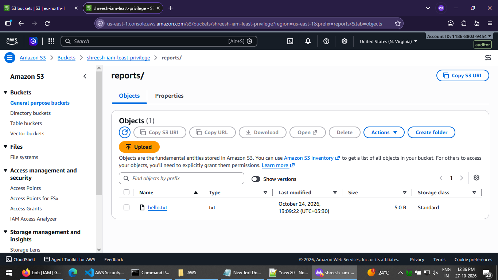

The permission came entirely from the role — `bob` holds none of it directly.
*(Hardening note: a real cross-account trust policy would also require `sts:ExternalId`
and/or `aws:MultiFactorAuthPresent`; those are tested via the CLI `aws sts assume-role`.)*

---

## Part 3 — Permissions boundary (a ceiling an admin grant can't cross)

**Scenario:** a user (`carol`) is given the full `AdministratorAccess` managed policy,
but a **permissions boundary** caps her effective permissions to S3 and CloudWatch only.
The boundary does not *grant* anything — effective permission = identity policy ∩ boundary.

```
IAM user: carol
   ├── permission policy:  AdministratorAccess       → would allow everything
   └── permissions boundary: boundary-s3-cw-only     → max = s3 / cloudwatch / logs only
   ⇒ effective = AdministratorAccess ∩ boundary = S3 / CloudWatch only
```

Policy: [`policies/boundary-s3-cw-only.json`](policies/boundary-s3-cw-only.json).

### Verification (IAM Policy Simulator)

| # | Action simulated | Expected | Result |
|---|------------------|----------|--------|
| 1 | `ec2:DescribeInstances` | Deny | ❌ **Implicitly denied by a permissions boundary** |
| 2 | `s3:*` (e.g. `DescribeJob`, `PutObjectRetention`) | Allow | ✅ Explicitly allowed |

**Despite `AdministratorAccess`, EC2 is denied by the boundary while S3 is allowed:**

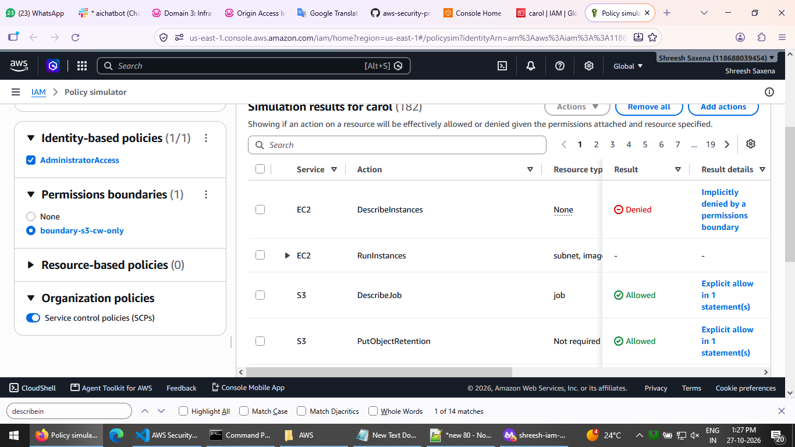

---

## Infrastructure as Code (CloudFormation)

The whole lab above was first built by hand in the console (for the screenshots), then
codified as a single **CloudFormation template** so it is reproducible and reviewable:
[`cloudformation/template.yaml`](cloudformation/template.yaml).

It creates all eight resources — the private bucket, the `S3ReportsReadOnly` managed
policy, the `reports-readers` group, the `reports-auditor-role` (trust + permission),
the `boundary-s3-cw-only` boundary, and the three users (`Alice`, `bob`, `carol`) — with
the right attachments, group membership, inline assume-role policy and permissions
boundary. The bucket name is a **parameter** (S3 names are globally unique), and the
role's trust policy references `bob` while `bob`'s assume-role policy references the role
by a built ARN, avoiding a circular dependency.

Deploy and tear down:

```bash
# Create the whole stack (console: Upload template → acknowledge IAM capabilities → Submit)
aws cloudformation deploy \
  --stack-name project1-iam-least-privilege \
  --template-file cloudformation/template.yaml \
  --parameter-overrides BucketName=<globally-unique-name> \
  --capabilities CAPABILITY_NAMED_IAM

# Delete everything in one step
aws cloudformation delete-stack --stack-name project1-iam-least-privilege
```

**The template visualized (console template designer) and a successful deploy:**

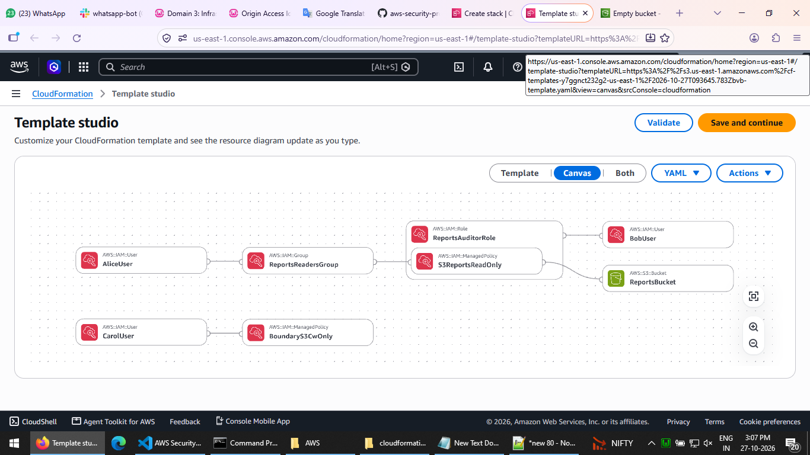
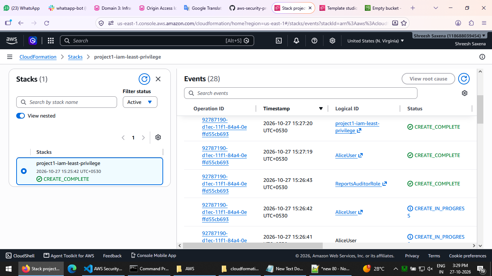

> One `delete-stack` removes every resource — far safer than deleting eight things by
> hand and forgetting one.

## Security scanning (cfn-lint + Checkov)

The template passes **cfn-lint** cleanly. **Checkov** findings were reviewed:

**Fixed**
- S3 bucket versioning enabled (`VersioningConfiguration: Status: Enabled`)

**Kept intentionally (with reason)**
- *S3 access logging off* — would require a separate log bucket; omitted for a
  short-lived test bucket.
- *IAM policy "unconstrained wildcard" checks* — these flag `boundary-s3-cw-only`, which
  is a **permissions boundary**. Its broad `s3:*` / `cloudwatch:*` on `Resource: *` is by
  design: a boundary caps the *maximum* permissions, never grants anything by itself, and
  is never attached as a permission policy.

## Key takeaways

- **Deny by default** — IAM grants nothing until explicitly allowed; everything else is already denied.
- **Conditions shrink scope** — an `s3:prefix` condition limits even a granted `ListBucket` to one folder.
- **Object-level ARNs matter** — `GetObject` on `bucket/reports/*` does not reach `bucket/secret.txt`.
- **Trust policy ≠ permission policy** — one controls *who can assume* a role, the other *what it can do*.
- **A permissions boundary is a ceiling, not a grant** — it caps the maximum even when `AdministratorAccess` is attached.
- **Attach permissions to groups**, not individual users, for maintainability.

## Cleanup

After documenting the project, delete the test users (`Alice`, `bob`, `carol`), the
group, the role, the customer-managed policies, and the S3 bucket. No credentials or
access keys are stored in this repository.

---

*Part of [aws-security-projects](../README.md) — hands-on labs for AWS Security.*
