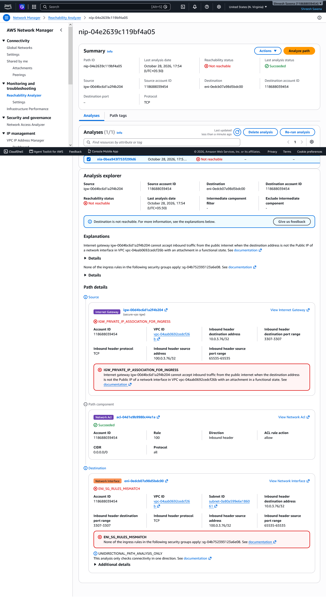
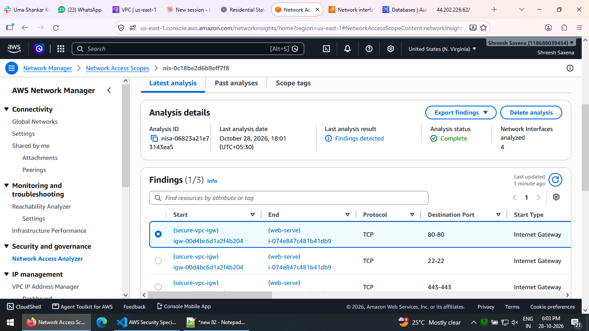
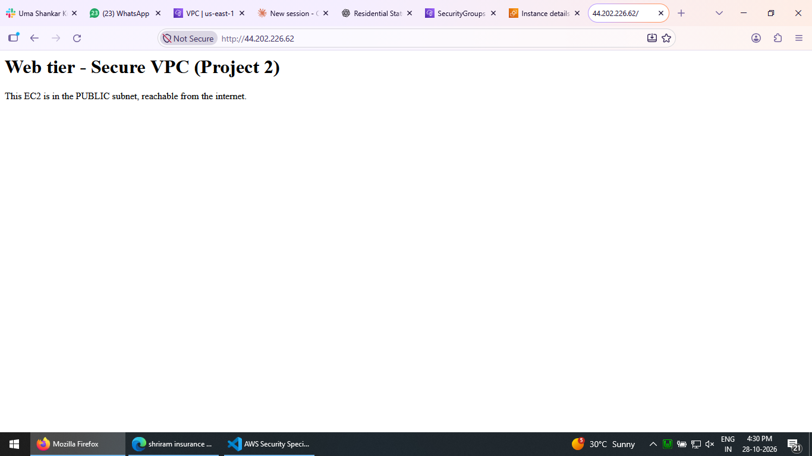

# Project 2 — Secure VPC (network least-privilege)

A hands-on, three-tier VPC where **only the right traffic flows**: the internet reaches
only the web tier, while the app and database tiers are isolated in private subnets with
outbound-only internet. Every access path is **verified** with two AWS tools — not just
assumed.

> **Why this matters:** most cloud breaches come from a resource being reachable that
> shouldn't be. This project shows a layered network (subnets + route tables + security
> groups + NACLs) that keeps the database unreachable from the internet by design, and
> proves it.

---

## Architecture

```
                         Internet
                            │
                     ┌──────┴───────┐
                     │  Internet GW │
                     └──────┬───────┘
  VPC 10.0.0.0/16           │
  ┌───────────────────────────────────────────────────────────┐
  │  Public subnet 10.0.1.0/24 (AZ-a)                           │
  │     • web EC2  (web-sg: 80/443 from internet, 22 from myIP) │
  │     • NAT Gateway ──────────────┐ (outbound for private)    │
  ├─────────────────────────────────┼───────────────────────────┤
  │  Private subnet 10.0.2.0/24 (AZ-a)   → route to NAT          │
  │     • app EC2  (app-sg: 8080/22 only from web-sg)           │
  │  Private subnet 10.0.3.0/24 (AZ-b)   → route to NAT          │
  │     • RDS MySQL (db-sg: 3306 only from app-sg)  [2 AZs]      │
  └───────────────────────────────────────────────────────────┘

  Security-group chain:  Internet → web-sg → app-sg → db-sg
```

- **Public subnet** routes to the Internet Gateway (two-way). **Private subnets** route
  to the **NAT Gateway** (outbound only — the internet cannot start a connection in).
- **Security groups are chained by reference, not by IP:** `app-sg` allows only `web-sg`,
  `db-sg` allows only `app-sg`. Each tier accepts traffic only from the tier above it.
- RDS needs two AZs, so there are two private subnets (one per AZ) in a DB subnet group.

## What was built

VPC · 3 subnets (1 public, 2 private across 2 AZs) · Internet Gateway · NAT Gateway (+ Elastic IP) ·
2 route tables (public→IGW, private→NAT) · 3 security groups (web/app/db chain) · a web EC2
(serving a page) · an app EC2 · a private **MySQL RDS** (`db.t3.micro`).

## Verification

Two complementary AWS tools were used — one checks a single path, the other audits the whole network.

### 1. Reachability Analyzer (one path at a time)

| Path | Expected | Result |
|------|----------|--------|
| Internet → app EC2 | Deny | ❌ **Not reachable** (no public IP **and** app-sg blocks — two layers) |
| web EC2 → app EC2 | Allow | ✅ **Reachable** (app-sg allows web-sg) |
| app EC2 → RDS | Allow | ✅ **Reachable** (db-sg allows app-sg, port 3306) |
| Internet → RDS | Deny | ❌ **Not reachable** (private, no public access) |



### 2. Network Access Analyzer (whole-network audit)

Using the Amazon-managed **All-IGW-Ingress** scope, the analyzer scanned every network
interface for paths from the internet into the VPC. **Every** finding points only to the
**web server** (ports 80/443/22) — there is **no** path from the internet to the app EC2
or the RDS instance.



### The web tier actually serves traffic

Opening the web server's public IP returns its page — proving the public subnet is
reachable from the internet (while the tiers behind it are not).



## Infrastructure as Code (CloudFormation)

The entire stack is codified in [`cloudformation/template.yaml`](cloudformation/template.yaml)
(22 resources) so it is reproducible and tears down in one command. The security-group
chain, NAT routing and the two-AZ DB subnet group are all expressed as code.

```bash
# Deploy
aws cloudformation deploy \
  --stack-name project2-secure-vpc \
  --template-file cloudformation/template.yaml \
  --parameter-overrides SshAllowedCidr=<your-ip>/32

# Tear everything down (VPC, NAT, RDS, EC2, ...) in one step
aws cloudformation delete-stack --stack-name project2-secure-vpc
```

The AMI is resolved automatically via an SSM public parameter, and the RDS master
password is generated and stored by **AWS Secrets Manager** (`ManageMasterUserPassword`),
so no secret is passed as a parameter or stored in the template.

## Security scanning (cfn-lint + Checkov)

The template passes **cfn-lint** cleanly (correctness), and was scanned with **Checkov**
(security). Each finding was reviewed — some fixed, some kept on purpose:

**Fixed**
- RDS encryption at rest (`StorageEncrypted: true`)
- RDS IAM database authentication (`EnableIAMDatabaseAuthentication: true`)
- A `Description` on every security-group rule

**Kept intentionally (with reason)**
- *HTTP 80 open to the internet* — this is a public web server; that rule is the whole point.
- *SSH 22 open* — only because the `SshAllowedCidr` parameter defaults to `0.0.0.0/0`;
  deploying with `SshAllowedCidr=<your-ip>/32` restricts it and clears the finding.
- *RDS Multi-AZ and enhanced monitoring off* — deliberately disabled to keep this a
  cost-controlled lab; both should be enabled for production.

> The point isn't a perfect score — it's reviewing every finding and making a deliberate
> decision, which is what a security engineer actually does.

## Key takeaways

- **Public vs private = routing, not a label.** A subnet is "public" because its route
  table points `0.0.0.0/0` at the Internet Gateway; private subnets point it at the NAT.
- **NAT is outbound-only.** Private instances can reach the internet to pull updates, but
  the internet cannot initiate a connection to them.
- **Chain security groups by reference.** `app-sg ← web-sg`, `db-sg ← app-sg` expresses
  intent ("only the tier above") and needs no IP maintenance.
- **Defense in depth.** The internet→app path is blocked by *two* independent layers (no
  public IP, and the security group) — either one alone would stop it.
- **Verify, don't assume.** Reachability Analyzer proves individual paths; Network Access
  Analyzer audits the whole network for any unintended exposure.

## Cost & cleanup

The NAT Gateway and RDS instance are **not** free-tier; everything else (VPC, subnets,
route tables, IGW, security groups) is free. The lab was built, verified, and then **torn
down the same day** (RDS, EC2, NAT Gateway, Elastic IP, then the VPC — which cascade-deletes
subnets, route tables, IGW and security groups). With CloudFormation this is a single
`delete-stack`.

---

*Part of [aws-security-projects](../README.md) — hands-on labs for AWS Security.*
