# 03 – GuardDuty Automated Incident Response (EC2 Auto‑Isolation)

> Detection → automated containment on AWS. When Amazon GuardDuty raises a finding
> on an EC2 instance, an EventBridge rule invokes a Lambda function that **isolates**
> the instance, takes a **forensic EBS snapshot**, **tags** it, and sends an **SNS alert** —
> with no human in the loop.

**Region:** us-east-1 · **Account:** `111122223333` (redacted) · **IaC:** Terraform (see [`terraform/`](terraform/))

---

## The story

A compromised EC2 instance beaconing to a command‑and‑control (C2) server is a race against
time — every minute it can exfiltrate data or move laterally. Manual response (someone reads the
alert, finds the instance, changes its security group) is too slow. This project builds a
**self‑contained auto‑response pipeline** that contains the threat in seconds.

## Scenario / requirements

- GuardDuty detects malicious behaviour on an EC2 instance (e.g. C2 DNS callback).
- The instance must be **isolated immediately** (cut off from the network).
- A **forensic snapshot** of its disk must be captured **before** anything is lost.
- The instance must be **tagged** as quarantined for the responders.
- The security team must get an **alert**.
- All of it **automatic**, **least‑privilege**, and **reproducible as code**.

## Architecture

```
                 malicious DNS / C2 callback
  EC2 instance ───────────────────────────────▶  Amazon GuardDuty
 (victim, in a VPC)                                     │  finding
                                                        ▼
                                              Amazon EventBridge rule
                                     { source: aws.guardduty,
                                       detail-type: "GuardDuty Finding" }
                                                        │
                                                        ▼
                                          AWS Lambda  (guardduty-auto-isolation)
                                                        │
        ┌───────────────────────────┬───────────────────�┬───────────────────────┐
        ▼                           ▼                   ▼                       ▼
  Replace instance SGs        CreateSnapshot        CreateTags             SNS publish
  with isolation SG           (forensics)       Status=ISOLATED          (email alert)
  (no inbound / no outbound)
```

## What I built (console, then codified in Terraform)

| # | Resource | Purpose |
|---|----------|---------|
| 1 | **Amazon GuardDuty** (enabled) | Detects the EC2 threat (agentless; reads VPC/DNS/CloudTrail feeds) |
| 2 | **Test EC2** `guardduty-victim-test` | The "victim" instance that gets isolated |
| 3 | **Isolation SG** `forensic-isolation-sg` | **0 inbound / 0 outbound** — fully cuts the instance off |
| 4 | **IAM role** `guardduty-isolation-lambda-role` | Least‑privilege role for the Lambda |
| 5 | **SNS topic** `guardduty-isolation-alerts` | Email alert to the security team |
| 6 | **Lambda** `guardduty-auto-isolation` | Isolate + snapshot + tag + notify ([code](lambda/lambda_function.py)) |
| 7 | **EventBridge rule** `guardduty-finding-to-isolation` | Routes GuardDuty findings → Lambda |

## How it was tested (real finding, not a sample)

Sample findings use **fake** instance IDs, so the Lambda can't isolate a real resource. Instead I
generated a **real** finding against the real instance: from the victim EC2 I resolved GuardDuty's
official test domain, which triggers `Backdoor:EC2/C&CActivity.B!DNS`:

```bash
for i in $(seq 1 10); do curl -s http://guarddutyc2activityb.com/ -o /dev/null; getent hosts guarddutyc2activityb.com; sleep 3; done
```

Within minutes GuardDuty raised the finding → EventBridge → Lambda → the instance was auto‑isolated.

### Verification (real run against the real instance)

**1 — GuardDuty raised the finding** `Backdoor:EC2/C&CActivity.B!DNS` (High, severity 8) on the instance:

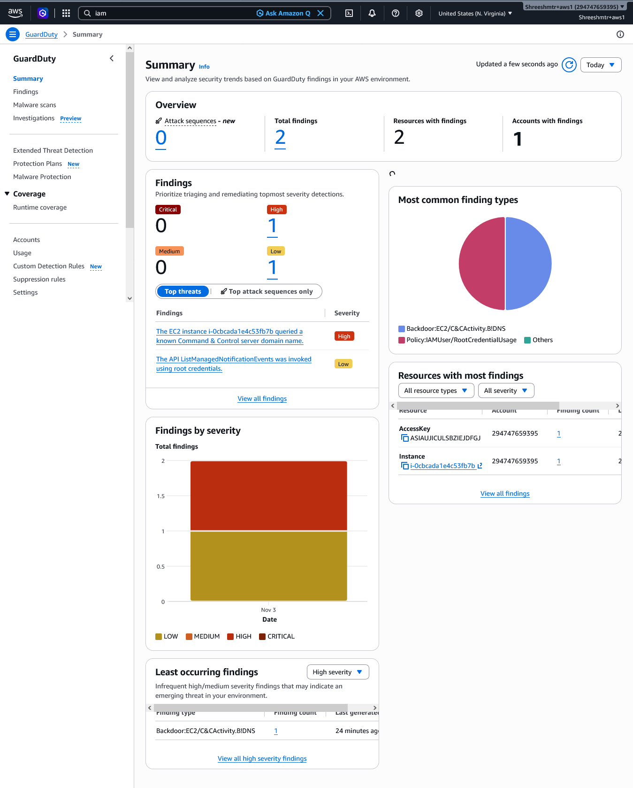

**2 — The instance was auto-isolated** — its security group was replaced with `forensic-isolation-sg` (0 in / 0 out):

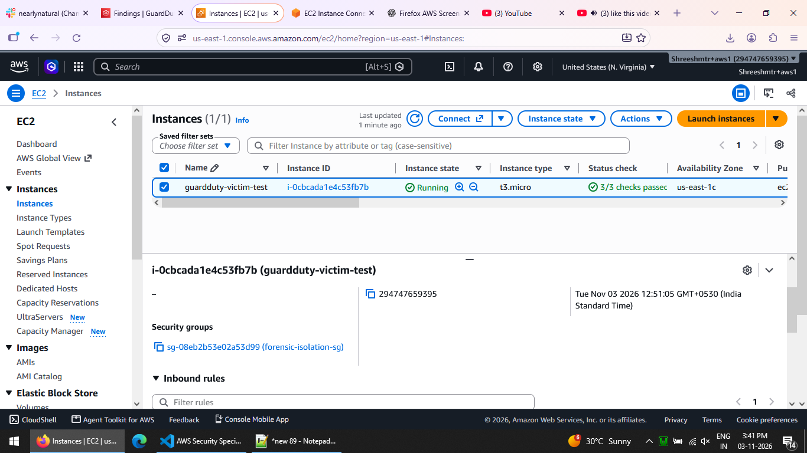

**3 — The instance was tagged** `Status=ISOLATED` (with who/when/which finding):

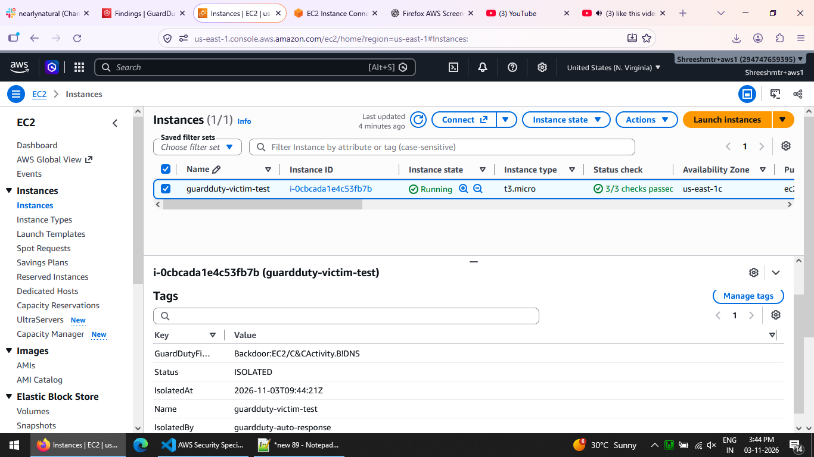

**4 — The Lambda run** (isolate + forensic snapshot + tag, all succeeded):

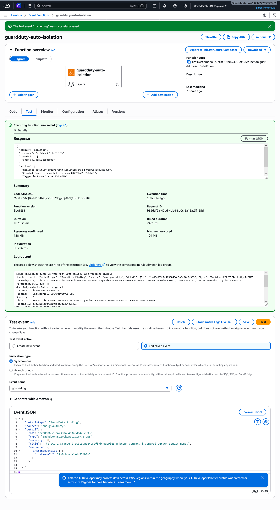

CLI confirmation of the forensic snapshot:

```
snap-042738a91c850dbd3  State: completed (100%)
Description: Forensic snapshot of vol-... from i-0cbcada1e4c53fb7b (Backdoor:EC2/C&CActivity.B!DNS)
Tags: Name=forensic-i-..., SourceInstance=i-..., GuardDutyFinding=Backdoor:EC2/C&CActivity.B!DNS
```

### A real bug I hit (and fixed)

On the live run the **snapshot step failed** with `SnapshotCreationPerVolumeRateExceeded`. GuardDuty emitted
the same finding several times (the finding's `count` climbed from 2 → 4), so EventBridge invoked the Lambda
repeatedly and the invocations raced `CreateSnapshot` on the **same volume**, tripping the per‑volume rate limit.
Isolation and tagging still succeeded — only the duplicate snapshots were throttled.

**Fix (in [`lambda/lambda_function.py`](lambda/lambda_function.py)):** an **idempotency guard** — the function
first checks whether the instance is already tagged `Status=ISOLATED` and, if so, returns early. That stops
duplicate finding events from re‑isolating and re‑snapshotting. I also added a short exponential back‑off/retry
around `CreateSnapshot` for transient throttling.

The two SNS alerts below tell the story — the live run (snapshot throttled) and a clean run (snapshot created):

| Live run — snapshot throttled | Clean run — snapshot created |
|---|---|
| 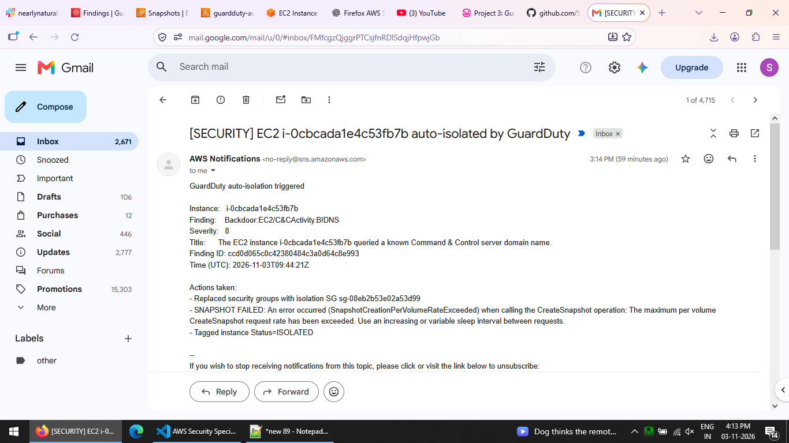 | 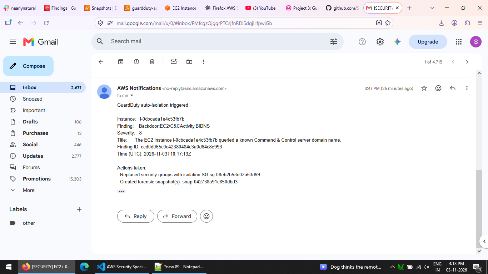 |

<details>
<summary><b>Build screenshots</b> (click to expand)</summary>

| GuardDuty enabled | Victim EC2 running | Isolation SG (0/0) |
|---|---|---|
| 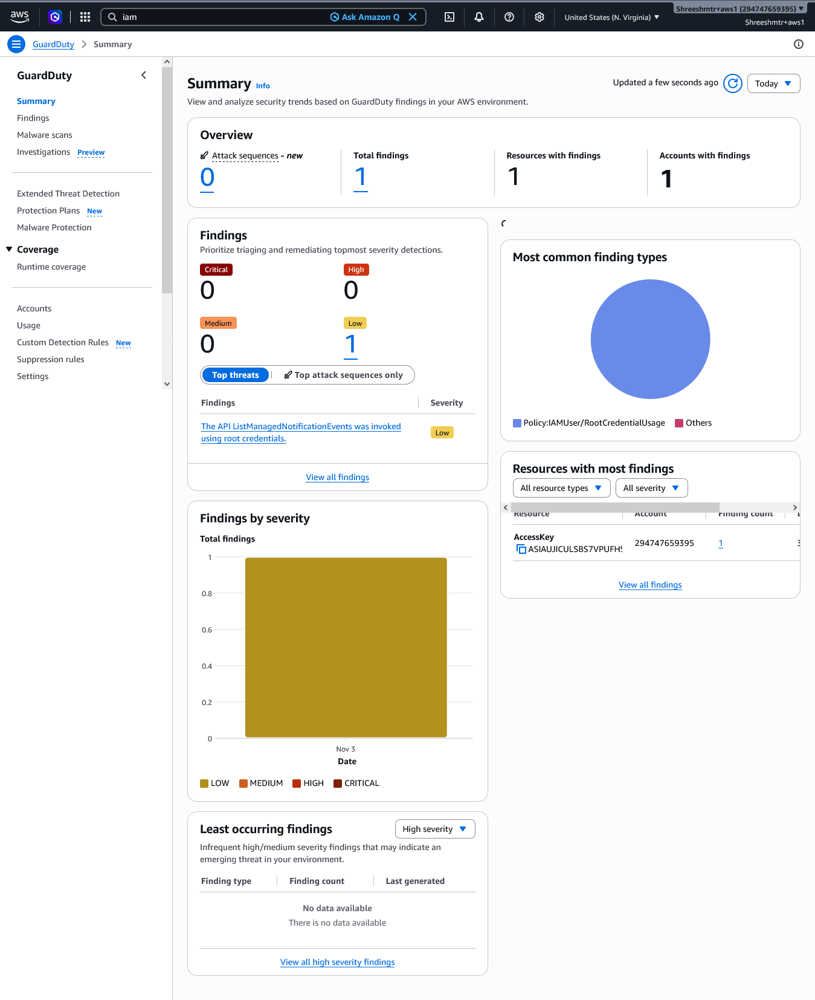 | 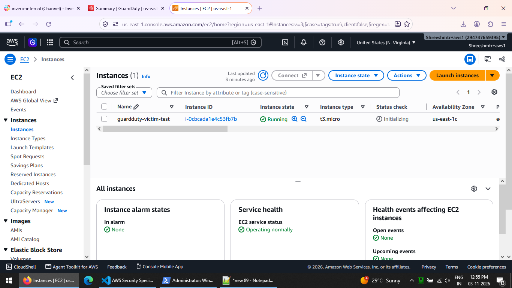 | 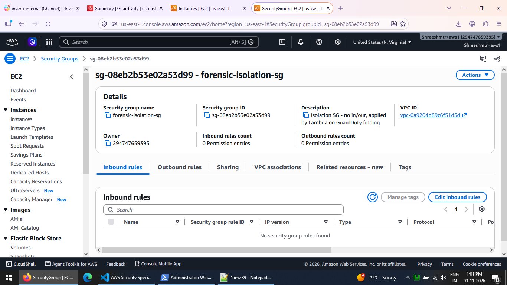 |

| Lambda IAM role | SNS subscription confirmed | EventBridge rule |
|---|---|---|
| 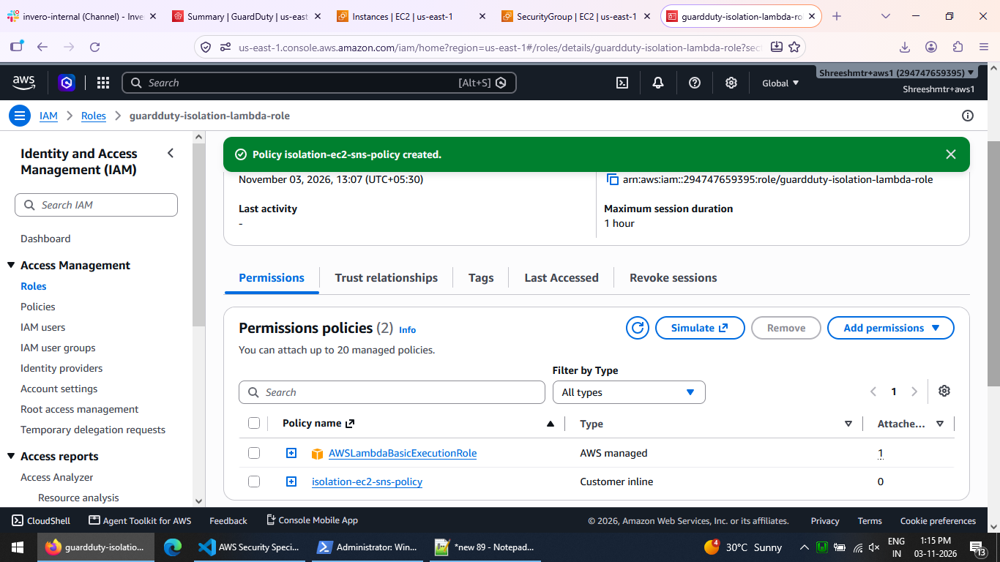 | 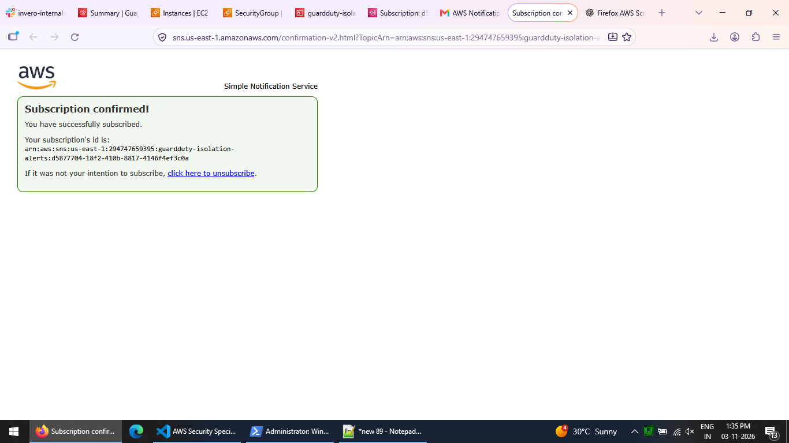 | 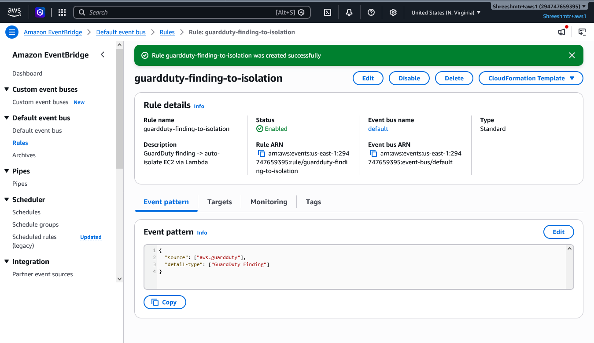 |

| Lambda code deployed | Lambda env vars |
|---|---|
| 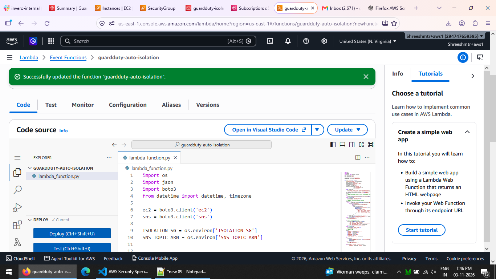 | 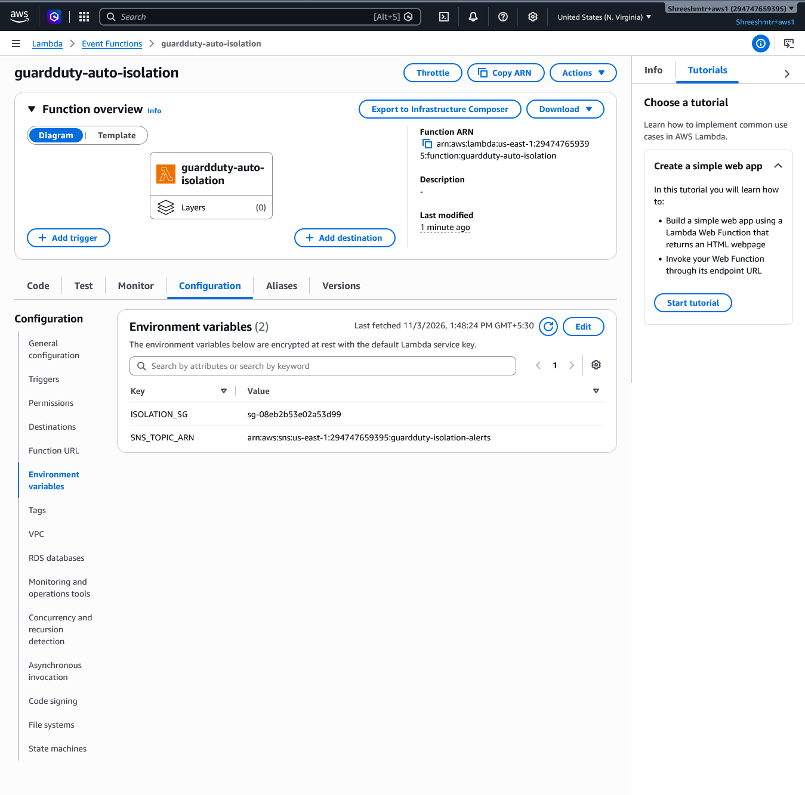 |

</details>

## Enterprise / production hardening (what I'd add at scale)

- **Severity filtering** in the EventBridge pattern (only isolate medium/high findings).
- **AWS Security Hub** (ASFF) as the single pane; GuardDuty + Inspector + Macie feed it.
- **Amazon Detective** for the investigation phase — after containment, its behaviour graph (CloudTrail + VPC flow + EKS logs) shows what the instance talked to and how far the compromise spread.
- **Step Functions** with a **human‑in‑the‑loop** approval before isolating production.
- **Separate forensics account** (cross‑account snapshot copy) for chain of custody.
- **GuardDuty delegated admin** across an AWS Organization (multi‑account).
- **Tighter IAM**: scope `ec2:ModifyInstanceAttribute` / `CreateSnapshot` with tag conditions
  (the demo uses `Resource: *` on describe/modify, which don't support resource scoping cleanly).
- Ticketing / ChatOps: Jira, Slack, PagerDuty from the same SNS topic.
- Metrics: track **MTTD / MTTR**; run periodic **game days**.

## Cleanup (done after the demo)

- Terminate the test EC2, delete the forensic snapshot.
- Delete the Lambda, EventBridge rule, SNS topic + subscription, isolation SG, IAM role.
- **Suspend/disable GuardDuty** (free for 30 days, then billed).
- Delete the `terraform-admin` access key used for Terraform.

---

*Part of [aws-security-projects](../README.md): identity → network → **detection/response** → data → governance.*
